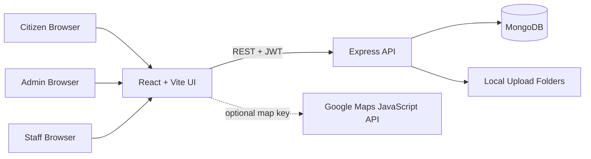
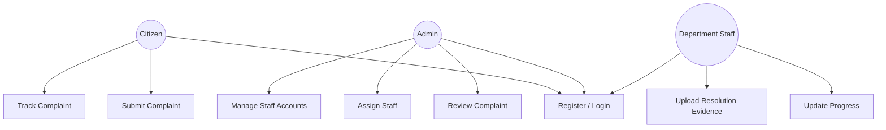
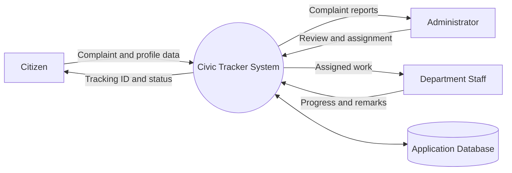
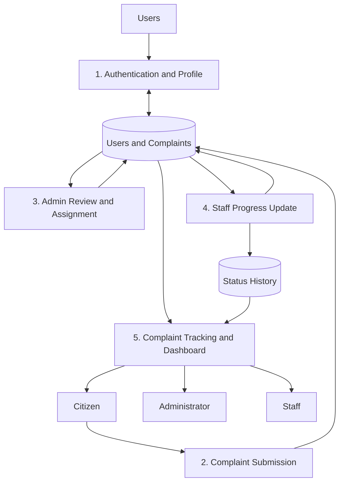
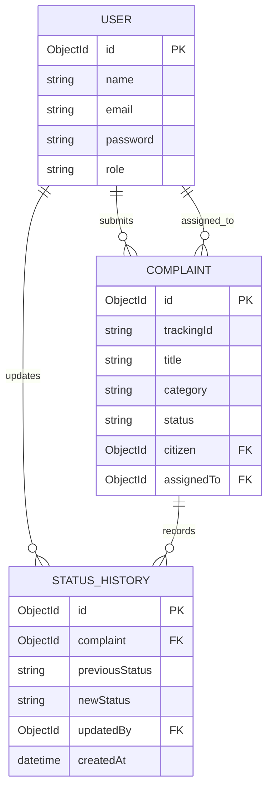

# CIVIC TRACKER SYSTEM – Academic Project Report

## 1. Abstract
Civic Tracker System is a web-based academic prototype for reporting local civic issues and tracking their progress. Citizens submit issue details, photographs and a location. Administrators review and assign complaints to department staff. Staff members update progress and record resolution evidence. The system demonstrates role-based access, REST APIs, persistent MongoDB records and a complaint status history.

## 2. Introduction
Local issues such as damaged roads, waste collection problems, water leakage and broken streetlights affect everyday community life. A centralized reporting workflow can make issue details and progress easier to follow. This project models that workflow as a full-stack web application.

## 3. Problem Statement
Informal reporting channels can make it difficult for a resident to retain a tracking reference or understand the current status of an issue. The prototype provides a structured complaint record and a visible status timeline.

## 4. Objectives
- Provide citizen registration and authentication.
- Capture civic complaint details, photographs and location.
- Allow administrators to review, assign or reject complaints.
- Restrict staff access to assigned complaints.
- Record status changes and remarks.
- Provide role-specific dashboards backed by database queries.

## 5. Scope
The MVP covers a local demonstration environment with three roles: citizen, admin and department staff. It is not integrated with government platforms and does not dispatch real municipal services.

## 6. Existing System
In an informal process, reports may be shared through calls, messages or in-person communication. Tracking references and consistent status history may not be available to the reporter.

## 7. Proposed System
A React client communicates with an Express REST API. The API authenticates users with JWT, checks roles and stores users, complaints and status history in MongoDB. Images are stored on the local server filesystem.

## 8. Functional Requirements
1. Citizen registration and login.
2. Complaint creation with category, description, address and optional images.
3. Optional coordinates and map selection.
4. Citizen complaint listing and detail tracking.
5. Admin review, staff assignment and rejection.
6. Staff assignment listing, progress remarks and resolution images.
7. Role-specific dashboards and profile editing.

## 9. Non-Functional Requirements
- Password hashing using bcrypt.
- Role and ownership checks on protected routes.
- Input/file constraints for complaint images.
- Responsive browser interface.
- Persistent storage through MongoDB.
- Clear local setup and environment configuration.

## 10. Technology Stack
React, Vite, JavaScript, Tailwind CSS, React Router, Axios, Express, Node.js, JWT, bcrypt, Multer, MongoDB, Mongoose, Recharts, Lucide React and optional Google Maps JavaScript API.

## 11. System Architecture

## 12. Use Case Diagram

## 13. DFD Level 0

## 14. DFD Level 1

## 15. ER Diagram

## 16. Database Design
- **User:** name, unique email, hashed password, role, contact fields, department and active flag.
- **Complaint:** unique tracking ID, category, description, address, coordinates, image paths, status, citizen reference, assigned staff reference and remarks.
- **ComplaintStatusHistory:** complaint reference, previous/new status, updater reference, remarks and timestamps.

## 17. Module Descriptions
- Authentication: citizen registration, login, JWT and bcrypt.
- Complaint management: submission, listing, details and tracking ID.
- Administration: review, assignment, rejection, citizen and staff management.
- Staff operations: assigned queue, progress updates and resolution evidence.
- Dashboard: MongoDB counts and category aggregation.
- Location and uploads: optional Google map, manual coordinates and local Multer storage.

## 18. API Overview
See the README API overview for method, endpoint and role access. All APIs are prefixed with `/api`; protected routes use a bearer JWT.

## 19. Testing
A repeatable manual test plan is: start MongoDB; run the seed script; check `/api/health`; authenticate as citizen, admin and staff; create a complaint; verify it appears for the citizen and admin; assign it to a staff account; confirm another staff account cannot access it; update progress; upload resolution evidence; and verify status history from the citizen account. Record actual outcomes when executing this plan. No test pass rate is asserted in this template.

## 20. Results
The intended result is a working local prototype connecting a React interface, Express REST API and MongoDB persistence. Actual test outcomes should be entered after running the application in the target environment.

## 21. Limitations
No official government integration, email/SMS, real-time sockets, password recovery or production hosting. Local file storage is not a substitute for a resilient production object store. Google Maps requires a separately configured key and may incur charges.

## 22. Future Scope
Potential future work includes verified institutional integrations, email notifications, stronger audit logs, moderation queues, accessibility testing, automated test coverage, deployment hardening and secure cloud storage.

## 23. Conclusion
Civic Tracker demonstrates a practical full-stack complaint workflow with role-based access, persistent records, local image uploads and status tracking. It is suitable as a foundation for an academic demonstration and further supervised development.

## 24. References
- React documentation: https://react.dev/
- Express documentation: https://expressjs.com/
- MongoDB documentation: https://www.mongodb.com/docs/
- Mongoose documentation: https://mongoosejs.com/docs/
- Google Maps JavaScript API documentation: https://developers.google.com/maps/documentation/javascript
